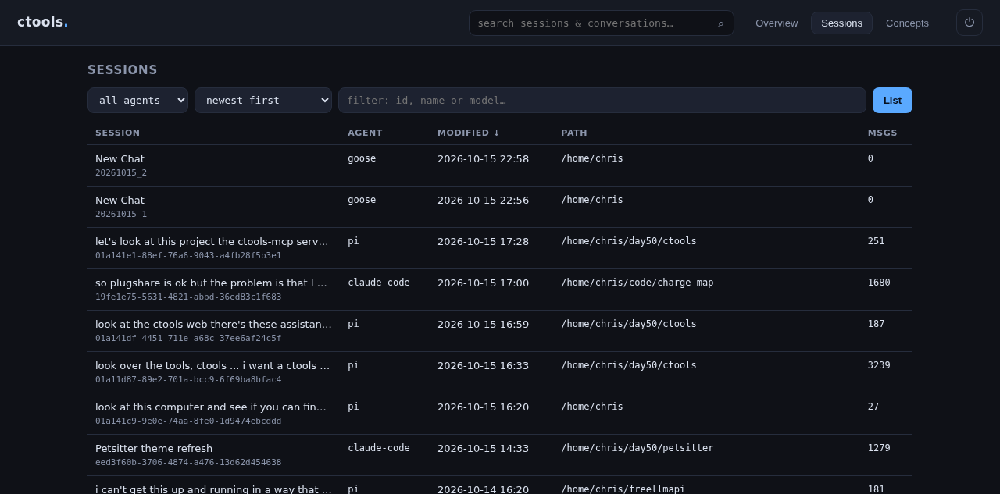
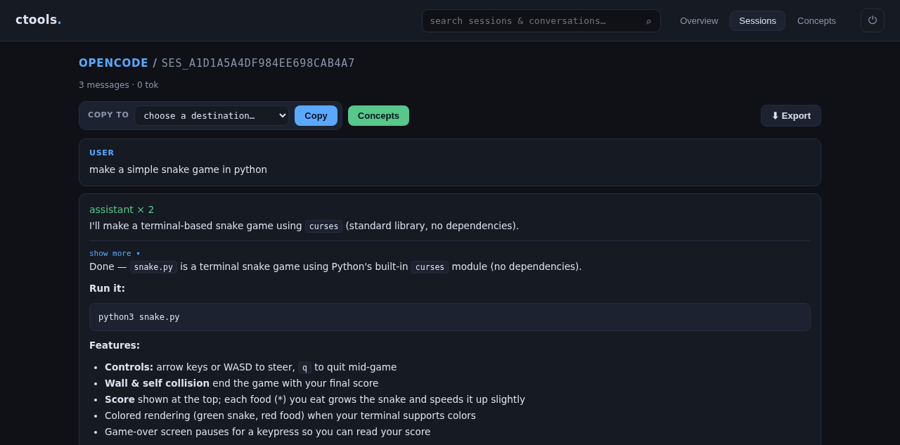
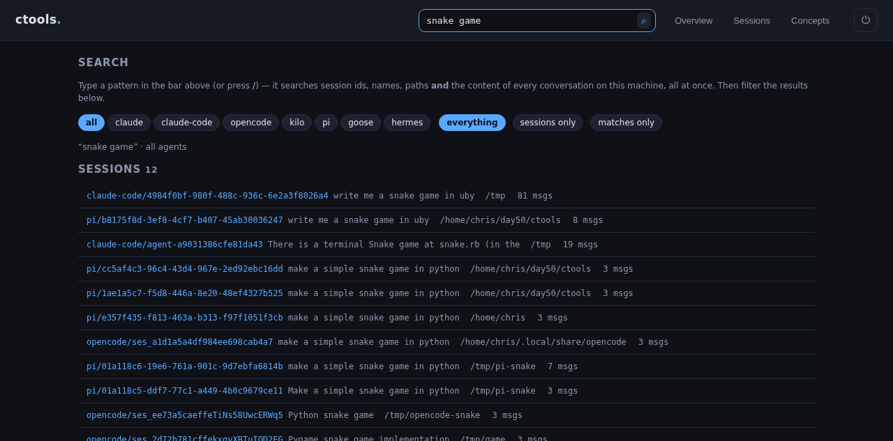
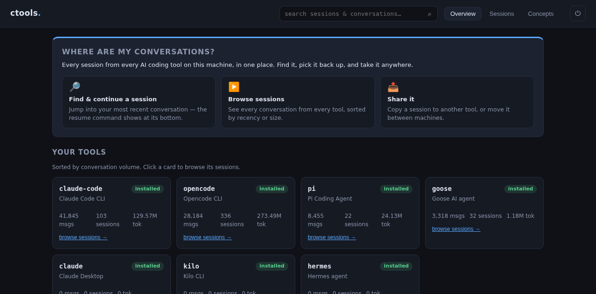

# ctools

<p align="center">
<br/>
<a href=https://pypi.org/project/ctxttools></a>
<br/><br/><b>Try it now</b><br/>
<code>uvx --from ctxttools cdir</code>
<br/><br/><b>Then install it</b><br/>
<code>uv tool install ctxttools</co

------
**ctools** is a suite of simple tools for navigating through the sessions of the most popular LLM agents and coding tools. It allows you to search your history, transfer conversations, filter them, and even share them among machines and users.

It supports [Claude Desktop](https://claude.com/download), [Claude Code](https://github.com/anthropics/claude-code), [Codex](https://github.com/openai/codex), [Pi](https://github.com/earendil-works/pi), [Hermes](https://github.com/NousResearch/hermes-agent), [Goose](https://github.com/aaif-goose/goose), [Kilo](https://github.com/Kilo-Org/kilocode), [FreeBuff](https://github.com/CodebuffAI/freebuff), [Cline](https://github.com/cline/cline), [omp](https://github.com/can1357/oh-my-pi), and [OpenClaw](https://openclaw.ai/).

You can use it from the terminal, from a small web dashboard, or from any AI coding agent (via an MCP server).

Here's an example:

> I look for mentions of snake game in opencode using cgrep
<pre>
$ <b>cgrep</b> "snake game" opencode
opencode/ses_a1d1a5a4df984ee698cab4a7:1:user: make a simple snake game in python
opencode/ses_a1d1a5a4df984ee698cab4a7:2:assistant: I'll make a terminal-based snake game using `curses` (standard library, no dependencies).
opencode/ses_a1d1a5a4df984ee698cab4a7:3:assistant: Done — `snake.py` is a terminal snake game using Python's built-in `curses` module (no dependencies).
</pre>

> cool let's look at the status of that session using cdir
<pre>
$ <b>cdir</b> -l opencode/ses_a1d1a5a4df984ee698cab4a7
  ID                            NAME                                MODIFIED            SIZE  MSGS  PATH
  ses_a1d1a5a4df984ee698cab4a7  make a simple snake game in python  2026-10-07 16:56  2.7 KB     3  /home/chris/.local/share/opencode

  1 session(s)
</pre>

> Alright let's copy that session from opencode into pi!
<pre>
$ <b>ccopy</b> opencode/ses_a1d1a5a4df984ee698cab4a7 pi
Copied 3 message(s) from opencode/ses_a1d1a5a4df984ee698cab4a7 to a new pi session: e357f435-f813-463a-b313-f97f1051f3cb
Resume it with:
  pi --session e357f435-f813-463a-b313-f97f1051f3cb
</pre>

As you can see, these are unix-friendly tools using simple paradigms that you are already familiar with.

## What it can do

| Capability | What you get |
|---|---|
| **Discover** | See every agent installed on your machine and how many sessions each holds. |
| **Find** | Search across all sessions at once: a pattern or a phrase (fuzzy, across word boundaries). |
| **Continue** | Get the exact command to resume a session in its original tool, or open it in the web UI. |
| **Copy** | Extract a session and copy it into another tool's session storage, or into a `.json` file. |
| **Export** | Download a session as JSON, or pretty-printed text/Markdown for reading or sharing. |
| **Concepts** | Pull out the *intent* of a session: what it's about, its constraints, what was decided. |
| **Search in bulk** | A small CLI that greps across all sessions for the first matching message, with context. |

```bash
$ ctools find "mcp config"
[1] claude-code  a1b2c3...
     (claude-code/2026-05-01) "…let me check the mcp config for you…"

$ ctools resume claude-code a1b2c3...
  claude --resume a1b2c3...
```

---

## A quick tour

**The overview**: every tool ctools can see, with session counts and token
totals, plus quick links into the most common actions:


**Sessions**: browse every conversation from any tool, sorted by recency.
Click one to open it.



**A conversation**: the full message stream, with the original tool's
resume command and copy-to-another-tool options.



**Search**: type a phrase and see every matching message across all tools.



**Concepts**: ask a session what it's *about*. ctools extracts the intent,
constraints, and decisions so you can pick up where you left off without
re-reading everything.



---

## Install

**Python 3.10+** is required.

```bash
pip install ctxttools
```

This installs three commands:

| Command | Purpose |
|---|---|
| `ctools` | The main CLI: agents, find, copy, resume, and more. |
| `ctools-web` | The dashboard (browser). |
| `ctools-mcp` | The MCP server for AI agents. |

To install just the MCP server (or the dashboard) without the full CLI:

```bash
pip install "ctxttools[mcp]"
# or: pip install "ctxttools[web]"
```

From a local checkout, `uv` keeps it editable and reproducible:

```bash
uv tool install --editable ".[mcp]"          # or ".[mcp,web]" for the dashboard too
```

> **Heads up:** `ctools-mcp` needs `mcp<2` (see
> [mcp dependency](#mcp-dependency) below).

---

## The CLI

### Discover your tools

```bash
ctools agents            # table of installed agents
ctools agents --json     # machine-readable
```

### Find and continue a session

`find` looks for a **pattern** (a literal string, case-insensitive) or a
**phrase** (`--phrase`, matched fuzzily across word boundaries).

```bash
ctools find "bug report"                    # all agents, pattern match
ctools find "refactor the parser" --phrase  # fuzzy phrase
ctools find "deploy" --agent claude-code    # one agent only
```

Each result shows the agent, a short id, when it ran, and the first matching
message. To resume it in its own tool:

```bash
ctools resume <agent> <session-id>
```

> **Why this matters:** when you're mid-task in one agent and need to
> continue in another (e.g. you started in Claude Code but now want to use
> Pi), `find` + `resume` is how you get back into the same thread.

### Copy a session to another tool

```bash
ctools copy <agent> <session-id> \
  --to claude-code \
  --mode copy            # or "move" to also erase the source
```

`copy` writes the session into the destination tool's storage in its native
format. `move` additionally clears the source (use with care).

### Search across all sessions (bulk)

```bash
ctools search "fix the flaky test" --agent opencode --context 3
```

Prints the first matching message per session with N lines of context,
handy when you're hunting for where a decision was made.

### What else is there

Run `ctools --help` to see the full list (including `tokens`, `export`, and
`version`).

---

## The web dashboard

```bash
ctools-web                    # opens at http://127.0.0.1:8799
ctools-web --port 9000        # a different port
```

The dashboard is a read-mostly surface over the same data the CLI uses.
You can:

- Browse and search sessions (the "Conversation" view mirrors the CLI).
- Copy a session to another tool right from the UI.
- Export/download a session.
- Run **concept extraction** on a session (with optional LLM-backed
  strategies and filters).

It binds to `127.0.0.1` only by default, so it's not exposed to your
network. Use `--host` to change that deliberately.

---

## Concepts: extract the intent of a session

A raw session is thousands of tokens. **Concepts** distills it into the few
things that matter for picking it back up: the goal, the constraints, and
what was decided.

```bash
ctools concepts <agent> <session-id>
```

Concepts are extracted with one of three paths, chosen automatically:

1. **Regex (default)**: built-in patterns for goal, decision, constraint,
   and preference. No setup.
2. **LLM strategy**: you define a chunking strategy that an LLM applies to
   the session. Best for richer, contextual extraction.
3. **Filter**: narrow the regex/LLM output with a rule (drop boilerplate,
   keep only certain types, etc.).

Strategies and filters are stored as JSON config files that ctools reads at
runtime. Create them in the dashboard (the **Concepts** tab) or by hand:

```bash
ctools strategies list
ctools filters list
```

The dashboard shows the full extraction pipeline (conversation → extraction
→ filter → concepts) so you can see exactly what was kept and why.

---

## MCP server

The MCP server exposes the same capabilities to any MCP-capable coding agent
(Pi, Claude, OpenCode, etc.).

### Install and register with Pi

```bash
ctools-mcp install
```

This installs the server (via `uv tool` if available, else `pipx`) and
registers it in `~/.pi/agent/mcp.json`. Verify with:

```bash
pi mcp list        # "ctools-mcp … connected"
```

### Manual registration (any host)

If you'd rather wire it up yourself, `print-config` emits the JSON snippet
for a given host:

```bash
ctools-mcp print-config pi
```

Add that to your host's MCP config (`~/.pi/agent/mcp.json` for Pi). The
server is started with `python -m ctools.ctools_mcp` from the install
environment.

### Tools exposed

| Tool | What it does |
|---|---|
| `list_agents` | Agents available and whether they're installed. |
| `list_sessions` | Recent sessions for one agent. |
| `search_sessions` | Find a session by pattern/phrase. |
| `export_session` | Get the messages (or export) for a session. |
| `copy_concepts` | Copy extracted concepts into a destination session. |
| `get_concepts` | Extract concepts from a session. |
| `list_strategies` / `list_filters` | Show available LLM/filter configs. |

---

## MCP dependency

`ctools-mcp` pins `mcp>=1.2,<2.0`. The `mcp` package 2.x renamed
`FastMCP` to `MCPServer`, which breaks the v1 API ctools uses. If a fresh
install pulls `mcp>=2` and `ctools-mcp` won't start, pin the major version
(`pip install "mcp<2"`); the released package already does this.

---

## The agents ctools knows about

| Name | Tool | Storage |
|---|---|---|
| `pi` | Pi coding agent | JSONL |
| `claude` | Claude Desktop | JSON |
| `claude-code` | Claude Code CLI | JSONL |
| `opencode` | OpenCode CLI | SQLite |
| `goose` | Goose AI agent | JSONL |
| `kilo` | Kilo CLI | JSONL |
| `hermes` | Hermes agent | SQLite |

An agent is "installed" if ctools can find its session directory (or DB
file). Uninstalled agents are still listed but skipped by `find`/`copy`.

---

## How the data is handled

- **Read-only by default.** `find`, `search`, `list_sessions`, and the
  dashboard's read paths never modify your session files.
- **Writes are explicit.** Only `copy`/`move` and `copy_concepts` write, and
  only to a session you name as the target.
- **Local only.** The dashboard binds to `127.0.0.1`; the MCP server reads
  your local session storage. Nothing leaves your machine.

---

## Development

```bash
git clone https://github.com/day50-dev/ctools
cd ctools
python -m venv .venv && . .venv/bin/activate
pip install -e .
python -m pytest
```

The code is deliberately simple: each agent adapter is one file under
`ctools/`, and the CLI/dashboard/MCP layers are thin over the shared
`ctools.agents` registry.

---

## License

[MIT](LICENSE)
